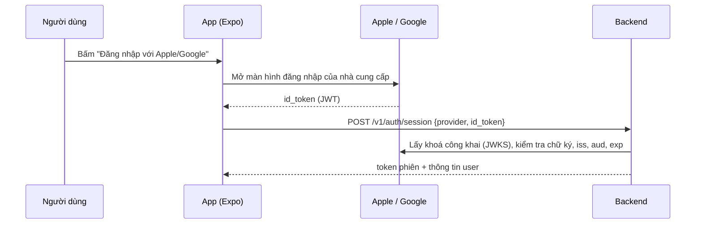

# Cấu hình đăng nhập Apple và Google (app iOS phát hành qua tài khoản Apple thuê)

Cập nhật: 2026-10-31

Tài liệu này dành cho người code app và backend. Nó liệt kê những gì cần nhờ bên giữ tài khoản Apple Developer (gọi tắt là **bên cho thuê**) làm, những gì bạn tự cấu hình trên Google Cloud, backend và EAS, và cách kiểm tra trước khi nộp App Store.

Giả định: app phát hành lâu dài dưới tài khoản Apple của bên cho thuê và không chuyển sang tài khoản khác.

## Mục lục

1. [Tóm tắt](#1-tóm-tắt)
2. [Luồng đăng nhập trong code](#2-luồng-đăng-nhập-trong-code)
3. [Việc cần nhờ bên cho thuê](#3-việc-cần-nhờ-bên-cho-thuê)
4. [Chọn cách build và ký app](#4-chọn-cách-build-và-ký-app)
5. [Cấu hình Google Cloud](#5-cấu-hình-google-cloud)
6. [Cấu hình backend](#6-cấu-hình-backend)
7. [Cấu hình app mobile và EAS](#7-cấu-hình-app-mobile-và-eas)
8. [Kiểm tra trước khi nộp](#8-kiểm-tra-trước-khi-nộp)
9. [Lỗi thường gặp](#9-lỗi-thường-gặp)
10. [Lưu ý và việc còn mở](#10-lưu-ý-và-việc-còn-mở)

## 1. Tóm tắt

Code đăng nhập Apple và Google đã xong ở cả app và backend. Việc còn lại chỉ là cấu hình:

| Phía | Việc phải làm | Ai làm |
|---|---|---|
| Apple | Đăng ký Bundle ID `com.durianfarm.mobile`, bật **Sign in with Apple** và **Push Notifications**, tạo app trên App Store Connect | Bên cho thuê (hoặc bạn, nếu được cấp quyền) |
| Apple | Cung cấp **Team ID** | Bên cho thuê |
| Google Cloud | Tạo 3 OAuth client: Web, iOS, Android; đưa màn hình xin quyền (consent screen) sang **In production** | Bạn |
| Backend | Đặt `APPLE_CLIENT_IDS` và `GOOGLE_CLIENT_IDS` | Bạn |
| EAS | Đặt biến môi trường production cho app | Bạn |

Đăng nhập Apple **không** cần Services ID, không cần file key `.p8` và không cần khai báo domain email, vì:
- app chỉ hiện nút Apple trên iOS, không dùng trên Android hoặc web;
- backend kiểm tra token bằng khoá công khai của Apple, không gọi API riêng của Apple;
- backend không đọc email, nên không phải gửi thư qua địa chỉ ẩn danh `@privaterelay.appleid.com`.

## 2. Luồng đăng nhập trong code



| File | Vai trò |
|---|---|
| `durianMobile/src/services/authProvider.ts` | Lấy `id_token` từ Apple (`expo-apple-authentication`) hoặc Google (`@react-native-google-signin/google-signin`) |
| `durianMobile/src/config/index.ts` | Đọc các Google client ID từ biến môi trường |
| `durianMobile/app.json` | Bundle ID, `usesAppleSignIn`, plugin Google kèm `iosUrlScheme` |
| `durianBackend/app/auth/providers.py` | Kiểm tra token. Danh tính người dùng là cặp (`provider`, `sub`) |
| `durianBackend/app/config.py` | `APPLE_CLIENT_IDS`, `GOOGLE_CLIENT_IDS` |
| `durianBackend/app/api/v1/auth.py` | Endpoint `POST /v1/auth/session` |

Backend chỉ chấp nhận token khi trường `aud` (audience) nằm trong danh sách đã cấu hình:
- token Apple trong app native có `aud` là **Bundle ID**, tức `com.durianfarm.mobile`;
- token Google có `aud` là **Web client ID**, vì app truyền `webClientId` khi gọi `GoogleSignin.configure` (đúng cho cả iOS và Android).

## 3. Việc cần nhờ bên cho thuê

Gửi nguyên mục này cho bên cho thuê.

### 3.1 Thông tin cần họ gửi lại

1. **Team ID**: mã 10 ký tự, xem ở developer.apple.com, mục Membership details.
2. **Loại tài khoản**: Individual hay Organization. Điều này quyết định cách build ở [mục 4](#4-chọn-cách-build-và-ký-app).
3. **Apple ID (App ID số)** của app sau khi tạo trên App Store Connect, nếu bạn cần cho `eas submit`.

### 3.2 Việc cần họ làm trên Apple Developer

1. Vào **Certificates, Identifiers & Profiles**, mục **Identifiers**, tạo App ID kiểu *App* với Bundle ID **`com.durianfarm.mobile`** (Explicit).
2. Trong App ID đó, bật:
   - **Sign In with Apple**, chọn *Enable as a primary App ID*;
   - **Push Notifications** (app có entitlement `aps-environment`; thiếu là build lỗi).
3. Nếu họ là người tạo provisioning profile: sau khi bật các tính năng trên thì **tạo lại profile App Store**. Profile cũ không chứa tính năng mới, và khi đó app sẽ không ký được.

Nếu dùng EAS có quyền vào tài khoản Apple ([cách A hoặc B ở mục 4](#4-chọn-cách-build-và-ký-app)), bước 1 đến 3 có thể bỏ qua. EAS tự đồng bộ các tính năng này theo entitlements của app khi chạy `eas build`.

### 3.3 Việc cần họ làm trên App Store Connect

1. Tạo app mới: nền tảng iOS, Bundle ID `com.durianfarm.mobile`, tên hiển thị "Sầu Riêng AI" (hoặc tên đã thống nhất).
2. Điền thông tin bắt buộc khi nộp: link chính sách quyền riêng tư (dùng cùng giá trị với `EXPO_PUBLIC_PRIVACY_URL`), phần khai báo dữ liệu thu thập (App Privacy), và tài khoản demo cho người duyệt nếu cần.

### 3.4 Câu hỏi nên chốt với bên cho thuê

- Ai chạy `eas build` và `eas submit`, bạn hay họ?
- Họ có đồng ý cấp quyền cho bạn (mời vào team, hoặc tạo App Store Connect API key) không?
- Khi chứng chỉ phân phối hoặc profile hết hạn hằng năm, ai gia hạn?

## 4. Chọn cách build và ký app

Theo tài liệu Expo:
- với **tài khoản Individual**, chỉ **Account Holder** mới tạo được chứng chỉ và profile;
- với **tài khoản Organization**, Account Holder, Admin, hoặc App Manager có bật quyền *Access to Certificates, Identifiers & Profiles* đều làm được.

| Cách | Bên cho thuê cung cấp | Hợp với | Ghi chú |
|---|---|---|---|
| **A. Mời bạn vào team** (khuyên dùng) | Mời Apple ID của bạn trong App Store Connect, mục Users and Access, vai trò **Admin** hoặc **App Manager** có bật quyền *Access to Certificates, Identifiers & Profiles* | Tài khoản Organization | Bạn tự chạy `eas build` và `eas submit`. EAS tự tạo chứng chỉ, profile và bật tính năng. |
| **B. App Store Connect API key** | File `.p8`, **Key ID** và **Issuer ID** của một key có vai trò **Admin** | Organization; tiện khi không muốn chia sẻ đăng nhập 2 lớp | Tải key lên EAS (`eas credentials`). Dùng được cho cả build lẫn submit. |
| **C. Họ build và nộp** | Không cần đưa gì | Tài khoản Individual, hoặc khi họ không cấp quyền | Bạn đưa code (hoặc quyền vào project EAS). Họ đăng nhập Apple khi chạy `eas build -p ios --profile production` rồi `eas submit`. |

Khuyến nghị: dùng **A** nếu là tài khoản Organization, dùng **C** nếu là Individual. Không nên xin mật khẩu Apple ID của họ.

## 5. Cấu hình Google Cloud

Google không phụ thuộc vào tài khoản Apple. Bạn tự quản lý trong project Google Cloud của mình. Project hiện tại có số `353834200795`, theo client iOS mặc định trong `src/config/index.ts`.

### 5.1 Màn hình xin quyền (OAuth consent screen)

Vào Google Cloud Console, mục **Google Auth Platform**:
1. **Branding**: điền tên app, email hỗ trợ, link chính sách quyền riêng tư, domain của trang chính sách.
2. **Audience**: chọn *External*, rồi bấm **Publish app** để chuyển sang **In production**. Nếu để ở *Testing*, chỉ những email trong danh sách test mới đăng nhập được, và người duyệt của Apple sẽ bị chặn.
3. **Data access**: chỉ dùng các scope cơ bản `openid`, `email`, `profile`. Đây là scope không nhạy cảm nên không phải qua thẩm định scope. Nếu bạn tải logo lên phần Branding, Google có thể yêu cầu xác minh thương hiệu trước khi logo hiện ra.

### 5.2 Ba OAuth client cần có

Vào **Google Auth Platform**, mục **Clients**:

| Loại | Thông tin khi tạo | Dùng ở đâu |
|---|---|---|
| **Web application** | Không cần redirect URI | `EXPO_PUBLIC_GOOGLE_WEB_CLIENT_ID` (app) và `GOOGLE_CLIENT_IDS` (backend). Đây là `aud` của token. |
| **iOS** | Bundle ID `com.durianfarm.mobile`. Có thể điền **Team ID** của bên cho thuê và App Store ID khi đã có. | `EXPO_PUBLIC_GOOGLE_IOS_CLIENT_ID` và `iosUrlScheme` trong `app.json` |
| **Android** | Package `com.durianfarm.mobile` và **SHA-1** của chứng chỉ ký app | Không cần đưa vào code. Google đối chiếu package và SHA-1 lúc đăng nhập. |

Lưu ý cho client iOS:
- `iosUrlScheme` trong `app.json` là client ID iOS viết ngược: `com.googleusercontent.apps.<phần-số-và-chữ>`. Nếu tạo lại client iOS, phải sửa **cả** `EXPO_PUBLIC_GOOGLE_IOS_CLIENT_ID` **và** `iosUrlScheme`, rồi build lại app.
- Kiểm tra client iOS hiện tại (`353834200795-82pg...`) đang khai báo đúng Bundle ID `com.durianfarm.mobile`.

Lưu ý cho client Android: mỗi chứng chỉ ký là một client Android riêng, cùng package nhưng khác SHA-1. Thường cần:
- SHA-1 của keystore EAS, lấy bằng `npx eas-cli@latest credentials -p android`. Dùng cho bản build cài trực tiếp (APK nội bộ).
- SHA-1 trong **Google Play Console**, mục *Test and release*, *App integrity*, *App signing key certificate*. Dùng cho bản tải từ Google Play. Thiếu SHA-1 này thì đăng nhập Google trên bản phát hành Play sẽ lỗi `DEVELOPER_ERROR`.
- Nếu chạy debug bằng `expo run:android`, thêm cả SHA-1 của debug keystore.

## 6. Cấu hình backend

Thêm vào `.env` của server production. Giá trị là danh sách JSON:

```dotenv
APP_ENV=prod
APPLE_CLIENT_IDS=["com.durianfarm.mobile"]
GOOGLE_CLIENT_IDS=["<web-client-id>.apps.googleusercontent.com"]
SESSION_TTL_DAYS=30
```

| Biến | Giá trị | Giải thích |
|---|---|---|
| `APP_ENV` | `prod` | **Bắt buộc khác `dev`** trên server thật. Với `dev`, backend chấp nhận token giả `dev:...` và ai cũng đăng nhập được. |
| `APPLE_CLIENT_IDS` | `["com.durianfarm.mobile"]` | `aud` của token Apple trong app native. Để trống thì mọi lượt đăng nhập Apple đều bị từ chối với lỗi `invalid_provider_token`. |
| `GOOGLE_CLIENT_IDS` | `["<Web client ID>"]` | Chỉ cần Web client ID. Không cần thêm client iOS hay Android, vì `aud` của token luôn là Web client ID. |

Server phải gọi ra được `https://appleid.apple.com/auth/keys` và `https://www.googleapis.com/oauth2/v3/certs` để lấy khoá công khai. Nếu bị firewall chặn, API trả lỗi `service_unavailable`.

Kiểm tra nhanh sau khi deploy: gọi `POST /v1/auth/session` với `{"provider":"google","id_token":"dev:test"}`. Phải nhận lỗi `invalid_provider_token`; nếu nhận được token phiên thì `APP_ENV` đang sai.

## 7. Cấu hình app mobile và EAS

File `.env` của app nằm trong `.gitignore`, nên **build trên máy chủ EAS không đọc file này**. Hãy đặt biến production trên EAS:

```bash
npx eas-cli@latest env:create --environment production --name EXPO_PUBLIC_API_URL --value https://<api-domain> --visibility plaintext
```

```bash
npx eas-cli@latest env:create --environment production --name EXPO_PUBLIC_PRIVACY_URL --value https://<privacy-url> --visibility plaintext
```

```bash
npx eas-cli@latest env:create --environment production --name EXPO_PUBLIC_GOOGLE_WEB_CLIENT_ID --value <web-client-id>.apps.googleusercontent.com --visibility plaintext
```

```bash
npx eas-cli@latest env:create --environment production --name EXPO_PUBLIC_GOOGLE_IOS_CLIENT_ID --value <ios-client-id>.apps.googleusercontent.com --visibility plaintext
```

| Biến | Bắt buộc | Ghi chú |
|---|---|---|
| `EXPO_PUBLIC_API_URL` | Có | `app.config.js` dừng build production nếu thiếu |
| `EXPO_PUBLIC_PRIVACY_URL` | Có | Như trên |
| `EXPO_PUBLIC_GOOGLE_WEB_CLIENT_ID` | Có | Thiếu thì nút Google báo lỗi `auth_not_configured` |
| `EXPO_PUBLIC_GOOGLE_IOS_CLIENT_ID` | Nên có | Nếu thiếu, code dùng client iOS mặc định đã ghi sẵn |
| `EXPO_PUBLIC_USE_MOCK` | Đã đặt `false` trong `eas.json` | Không cần đặt thêm |
| `EXPO_PUBLIC_DEV_ID_TOKEN` | **Không** đặt cho production | Chỉ dùng khi phát triển |

Biến `EXPO_PUBLIC_*` được nhúng vào app và ai cũng đọc được. Client ID không phải bí mật nên đặt ở đây là an toàn. Tuyệt đối không đặt key bí mật vào biến `EXPO_PUBLIC_*`.

Phần native đã cấu hình sẵn trong `app.json`, không cần sửa:
- `ios.bundleIdentifier`: `com.durianfarm.mobile`;
- `ios.usesAppleSignIn: true` và plugin `expo-apple-authentication`, sinh entitlement `com.apple.developer.applesignin`;
- plugin `@react-native-google-signin/google-signin` kèm `iosUrlScheme`.

Thư mục `ios/` do Expo tự sinh và đã nằm trong `.gitignore`. Không sửa tay trong đó.

Build và nộp:

```bash
npx eas-cli@latest build -p ios --profile production
```

```bash
npx eas-cli@latest submit -p ios --profile production
```

## 8. Kiểm tra trước khi nộp

Kiểm tra trên bản TestFlight (bản ký bằng tài khoản của bên cho thuê), không chỉ trên simulator.

- [ ] Nút **Đăng nhập với Apple** hiện trên iPhone. Đăng nhập xong vào được app.
- [ ] Đăng xuất rồi đăng nhập Apple lại vẫn vào **đúng** tài khoản cũ, dữ liệu còn nguyên.
- [ ] Đăng nhập Google trên iPhone thành công.
- [ ] Đăng nhập Google trên Android, cả bản tải từ Play (internal testing) chứ không chỉ APK.
- [ ] Đăng nhập bằng một tài khoản Google **không** nằm trong danh sách test, để chắc màn hình xin quyền đã ở *In production*.
- [ ] Xoá tài khoản trong app chạy được. Apple bắt buộc phải có chức năng này khi app cho tạo tài khoản.
- [ ] Server production có `APP_ENV=prod`; token `dev:...` bị từ chối.

## 9. Lỗi thường gặp

| Triệu chứng | Nguyên nhân hay gặp | Cách xử lý |
|---|---|---|
| Không thấy nút Apple | Đang chạy trên Android hoặc web, hoặc iOS dưới 13 | Đúng như thiết kế: nút Apple chỉ hiện trên iOS |
| Apple báo lỗi ngay khi bấm (thường là `AuthorizationError` mã 1000), hoặc build lỗi thiếu entitlement | App ID chưa bật Sign In with Apple, hoặc profile tạo trước khi bật | Bật tính năng rồi tạo lại profile (hoặc chạy lại `eas build` để EAS đồng bộ) |
| Backend trả `invalid_provider_token` với Apple | `APPLE_CLIENT_IDS` trống, hoặc khác Bundle ID | Đặt `["com.durianfarm.mobile"]` rồi khởi động lại API |
| Backend trả `invalid_provider_token` với Google | `GOOGLE_CLIENT_IDS` không chứa đúng Web client ID mà app đang dùng | So sánh với `EXPO_PUBLIC_GOOGLE_WEB_CLIENT_ID` |
| Android báo `DEVELOPER_ERROR` | SHA-1 của chứng chỉ ký chưa được khai báo trong client Android | Thêm SHA-1 từ Play Console (App signing) và từ EAS |
| iOS: Google mở xong không quay về app | `iosUrlScheme` không khớp client iOS | Sửa `app.json` rồi build lại |
| Google báo app chưa được xác minh, hoặc chỉ một số người đăng nhập được | Màn hình xin quyền còn ở *Testing* | Publish sang *In production* |
| App báo `auth_not_configured` | Bản build thiếu `EXPO_PUBLIC_GOOGLE_WEB_CLIENT_ID` | Đặt biến trên EAS rồi build lại |
| API trả `service_unavailable` khi đăng nhập | Server không gọi được trang lấy khoá công khai của Apple hoặc Google | Mở kết nối ra ngoài cho hai domain ở mục 6 |

## 10. Lưu ý và việc còn mở

- **Danh tính Apple gắn với Team ID của bên cho thuê.** Mã `sub` mà Apple trả về chỉ có giá trị trong team đó. Vì app ở lâu dài dưới tài khoản của họ, việc này không gây vấn đề. Nếu sau này vẫn phải chuyển app, toàn bộ người dùng Apple sẽ cần quy trình chuyển đổi mã người dùng (transfer identifier) của Apple.
- **Sự phụ thuộc vào bên cho thuê.** Nếu tài khoản của họ hết hạn hoặc bị khoá, app bị gỡ khỏi App Store và đăng nhập Apple ngừng hoạt động. Nên ghi điều kiện gia hạn và thông báo trước vào hợp đồng.
- **Tên người dùng Apple.** Apple chỉ gửi họ tên ở lần đăng nhập đầu tiên, và không đưa tên vào `id_token`. Backend hiện đọc tên từ token, nên user đăng nhập bằng Apple sẽ không có tên hiển thị. Muốn có tên thì app phải gửi kèm `credential.fullName` ở lần đầu, và backend phải nhận thêm trường này.
- **Thu hồi token Apple khi xoá tài khoản.** `DELETE /v1/me` đang xoá dữ liệu nhưng chưa gọi API thu hồi token của Apple. Apple khuyến nghị làm việc này. Nếu cần, lúc đó mới xin bên cho thuê **key `.p8` có bật Sign in with Apple** và **Key ID**, và app phải gửi thêm `authorizationCode` cho backend.

### Câu hỏi cần chốt

- Tài khoản Apple của bên cho thuê là Individual hay Organization?
- Ai sở hữu tài khoản Google Play Console, để biết ai lấy SHA-1 phần App signing?
- Client iOS hiện tại trong Google Cloud đã khai báo đúng Bundle ID `com.durianfarm.mobile` chưa?

## Nguồn tham khảo

- Expo, iOS capabilities: https://docs.expo.dev/build-reference/ios-capabilities/
- Expo, Apple Developer Program roles and permissions: https://docs.expo.dev/app-signing/apple-developer-program-roles-and-permissions/
- Apple, vai trò thành viên team: https://developer.apple.com/help/account/manage-your-team/roles/
- Expo Apple Authentication: https://docs.expo.dev/versions/latest/sdk/apple-authentication/
- React Native Google Sign-In: https://react-native-google-signin.github.io/docs/setting-up/expo
